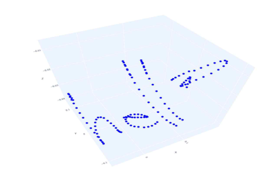
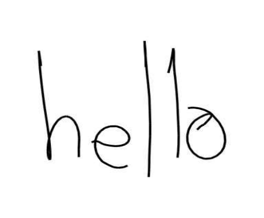
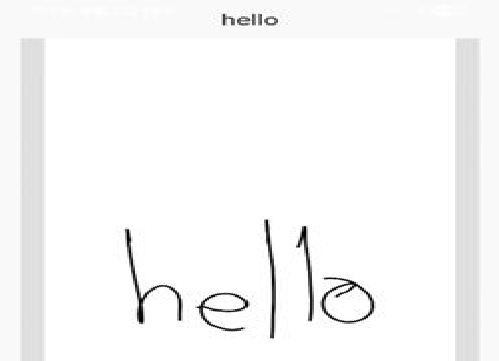
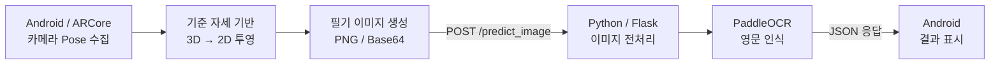

# Air Drawing | ARCore 기반 공중 필기 인식 시스템

스마트폰을 공중에서 움직여 기록한 **3차원 필기 궤적을 2차원 이미지로 투영하고, 딥러닝 OCR로 영문을 인식하는 Android–Python 시스템**입니다.

**2025년 · 3인 캡스톤디자인 프로젝트**  
**개인 담당:** 위치 추적 방식 검토, 공중 필기·3D→2D 투영 알고리즘, 필기 데이터 처리, Flask/PaddleOCR 백엔드 등 **기술 개발 전반** (기획·UI 디자인·앱 화면 구현 제외)

[시연 영상](https://www.youtube.com/shorts/3RjYSgrBuwM) · [캡스톤 논문](./논문_비전%20및%20관성%20센서%20융합을%20활용한%20직교%20투영%20기반%20딥러닝%20공중%20필기%20인식.pdf) · [시스템 설계](docs/architecture.md)

## Demo

[](https://www.youtube.com/shorts/3RjYSgrBuwM)

**사용 흐름:** 기준 자세 설정 → 화면을 터치한 채 스마트폰을 움직여 필기 → 2D 필기 이미지 생성 → OCR 인식 → 결과 확인

### 3D 궤적에서 2D 필기 이미지로

| 3D 필기 궤적 | 2D 직교 투영 결과 |
| :---: | :---: |
|  |  |
| 논문 그림 5 | 논문 그림 6 |

### Android OCR 인식 결과



*위 세 이미지는 2025년 캡스톤 논문의 그림 5·6·7에서 추출했습니다.*

> 스마트폰 카메라로 손가락 끝을 추적하는 방식이 아닙니다. **스마트폰 자체의 ARCore 카메라 Pose**로 공간 이동을 추적하고, 화면 터치로 필기 구간을 제어합니다.

## Project Overview & My Role

터치스크린이나 키보드 대신 **스마트폰의 공간 이동으로 문자를 입력하는 방식**을 구현하는 것이 목표였습니다. ARCore에서 3D 위치를 수집하고, 사용자가 설정한 기준 자세를 토대로 2D 이미지로 변환한 뒤 Flask/PaddleOCR 서버를 거쳐 문자 인식 결과를 출력합니다.

기획·UI 디자인·앱 화면 구현은 다른 팀원이 담당했으며, 다음 기술 개발을 직접 수행했습니다.

| 담당 영역 | 주요 구현 내용 |
| --- | --- |
| **공중 필기 위치 추적** | IMU 기반 위치 추정의 누적 오차 분석, ARCore 카메라 Pose 도입 |
| **3D 필기 데이터 수집** | 터치 상태에 따른 3D 좌표 기록, 이동 거리 필터링, 획 구분 |
| **3D → 2D 투영** | PCA 방식 검토, 기준 위치·카메라 방향에 따른 회전 및 직교 투영 알고리즘 구현 |
| **필기 이미지 처리** | 2D 좌표 렌더링, Bitmap 생성, Base64 인코딩 및 서버 요청 연동 |
| **OCR 백엔드** | Flask API, 필기 영역 검출·크롭·정규화, PaddleOCR 추론 및 결과 응답 |

**핵심 소스:** [ARCore 필기 입력](android-app/app/src/main/java/com/nkm/ar/core/java/views/AirWritingActivity.java) · [직교 투영](android-app/app/src/main/java/com/nkm/ar/core/java/utils/projectors/ReferencePoseProjector.java) · [이미지 전처리](python-backend/model/utils.py) · [Flask 서버](python-backend/server/app.py)

## Engineering Challenges & Decisions

### 1. IMU 위치 적분의 누적 오차 → ARCore Motion Tracking

**문제:** 초기에는 가속도·자이로센서 측정값으로 스마트폰의 이동 위치를 직접 추정하려 했으나, 가속도 적분 과정에서 오차가 누적되어 안정적인 필기 궤적을 얻기 어려웠습니다.

**해결:** 위치를 직접 적분하는 대신, 카메라 영상과 관성 정보를 융합하여 위치·자세를 추정하는 **ARCore Motion Tracking**을 채택했습니다. 기준점 설정 시 카메라의 위치·방향을 저장하고 필기 중 카메라 위치를 추적하도록 구현했습니다.

**결과:** 최종 시스템의 공중 필기 입력은 ARCore 카메라 Pose를 기반으로 동작합니다.

### 2. PCA 투영의 문자 방향 문제 → 기준 자세 기반 직교 투영

**문제:** 3D 궤적의 두 주성분을 2D 축으로 사용하던 PCA 투영에서는 입력 데이터에 따라 글씨가 회전하거나 뒤집히는 문제가 발생했습니다.

**해결:** 데이터의 분포에 따라 투영 축이 달라지는 방식 대신, **필기 시작 시 설정한 카메라 위치·방향**을 기준으로 좌표계를 정의했습니다. 각 3D 점에서 기준 위치를 빼고 회전한 뒤 깊이 성분을 제외하여 2D 좌표로 변환했습니다.

**결과:** 최종 앱에서 정상적인 방향의 2D 필기 이미지를 생성하고 이를 OCR 입력으로 사용했습니다.

[투영 알고리즘 코드](android-app/app/src/main/java/com/nkm/ar/core/java/utils/projectors/ReferencePoseProjector.java) · [설계 및 좌표 변환 상세](docs/architecture.md)

## System Architecture



| 구성 요소 | 기술 | 역할 |
| --- | --- | --- |
| Android | Java, ARCore, Apache Commons Math | 카메라 위치 수집, 좌표 변환, 직교 투영, 이미지 생성 |
| 통신 | Retrofit, JSON, Base64 | 필기 이미지 전송 및 인식 결과 수신 |
| 백엔드 | Python, Flask, Pillow, OpenCV | 이미지 디코딩, 글씨 영역 크롭 및 정규화 |
| OCR | PaddlePaddle, PaddleOCR | 영문 문자 추론 |

전처리 단계에서는 필기 영역을 검출·크롭한 뒤 종횡비를 유지하며 **384×384** 이미지로 정규화합니다. [상세 처리 과정](docs/architecture.md)

## Results

### 영단어 인식 실험

2025년 캡스톤 논문에서 보고한 공중 필기 영단어 인식 결과입니다.

| 항목 | 논문 보고 결과 |
| --- | --- |
| 데이터셋 | NGSL(New General Service List) 고빈도 영단어 **500종** |
| 입력 횟수 | 단어당 **2회**, 총 **1,000회** 공중 필기 |
| 정확히 인식한 입력 | **891회** |
| **영단어 인식 정확도** | **89.1%** |

논문에서는 필기 궤적의 중첩과 모양이 비슷한 문자 때문에 오인식이 발생했다고 분석했습니다. 예를 들어 `moon`이 `union`으로, `cool`이 `c001`로 인식된 사례를 보고했습니다.

**근거:** [캡스톤 논문 — 인식 성능 실험 및 결과 분석](./논문_비전%20및%20관성%20센서%20융합을%20활용한%20직교%20투영%20기반%20딥러닝%20공중%20필기%20인식.pdf#page=7)

## Getting Started

**필요 환경:** Android Studio/SDK, Java 17, Python 3.11, Flask 및 PaddleOCR 실행에 필요한 Python 패키지. 실제 공중 필기에는 **ARCore 지원 Android 실기기**가 필요합니다.

1. Python 3.11 가상환경을 준비하고 서버 의존성을 설치합니다. 아래는 **Linux CPU 환경** 예시이며, 다른 운영체제의 설정과 자세한 안내는 [서버 주소 설정 가이드](docs/android-ocr-server-config.md)를 참고하세요.

   ```bash
   python3.11 -m venv python-backend/.venv
   source python-backend/.venv/bin/activate
   python -m pip install -r python-backend/requirements-cpu.txt
   ```

   `python-backend/requirements.txt`는 GPU·실험용 패키지가 혼재한 기존 목록이므로 일반적인 CPU 설치에는 사용하지 않습니다.
2. 저장소 루트에서 OCR 서버를 실행합니다.

   ```bash
   python python-backend/server/app.py
   ```

3. Android 프로젝트(`android-app/`)를 열고 실제 접근 가능한 서버 주소를 지정해 Debug 앱을 빌드합니다. 로컬 에뮬레이터에서 호스트 PC의 Flask에 접속하는 설정 예시는 다음과 같습니다.

   ```bash
   ./gradlew :app:installDebug -PocrDebugBaseUrl=http://10.0.2.2:5000/
   ```

   Windows에서는 `gradlew.bat`를 사용합니다. `10.0.2.2`는 에뮬레이터 전용 주소이므로 실기기에서는 PC의 LAN 주소 등 접근 가능한 주소로 변경해야 합니다.

[Android 서버 주소 설정 가이드](docs/android-ocr-server-config.md)

## Documentation & Attribution

- [시스템 설계 및 알고리즘](docs/architecture.md)
- [Android OCR 서버 주소 설정](docs/android-ocr-server-config.md)
- [캡스톤 논문](./논문_비전%20및%20관성%20센서%20융합을%20활용한%20직교%20투영%20기반%20딥러닝%20공중%20필기%20인식.pdf)

Android 프로젝트의 AR 렌더링·앱 골격 일부는 **Google ARCore 샘플 코드**를 기반으로 하며, 해당 코드의 저작권 및 라이선스 고지를 유지합니다. 직접 담당한 기술 개발 영역은 위의 **My Role**에 구분했습니다.