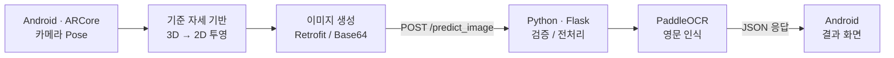

# Air Drawing | ARCore 기반 공중 필기 인식

**스마트폰의 움직임을 3차원 필기 궤적으로 수집하고, 이를 2차원으로 투영해 문자를 인식하는 Android–Python 시스템**입니다.

캡스톤 프로젝트에서 **공중 필기 알고리즘 전반과 Flask/PaddleOCR 서버 개발**을 담당했습니다. 관성센서만을 이용한 위치 추정의 누적 오차와 PCA 투영의 문자 방향 문제를 겪은 뒤, ARCore 카메라 Pose와 기준 자세 기반 직교 투영으로 설계를 변경했습니다.

**[시연 영상](https://www.youtube.com/shorts/3RjYSgrBuwM)** · **[시스템 설계](docs/architecture.md)** · **[테스트 근거](docs/testing.md)** · **[캡스톤 논문](./논문_비전%20및%20관성%20센서%20융합을%20활용한%20직교%20투영%20기반%20딥러닝%20공중%20필기%20인식.pdf)**

## Demo

**[실제 시연 영상 보기 (YouTube Shorts)](https://www.youtube.com/shorts/3RjYSgrBuwM)**

캡스톤 논문에는 [3D 필기 궤적과 2D 투영 이미지(그림 5·6, PDF 6페이지)](./논문_비전%20및%20관성%20센서%20융합을%20활용한%20직교%20투영%20기반%20딥러닝%20공중%20필기%20인식.pdf#page=6), [Android의 `hello` 인식 화면(그림 7, PDF 7페이지)](./논문_비전%20및%20관성%20센서%20융합을%20활용한%20직교%20투영%20기반%20딥러닝%20공중%20필기%20인식.pdf#page=7)이 포함되어 있습니다.

## My Contributions

**캡스톤 개발 당시 담당 분야**

| 분야 | 담당 구현 및 설계 |
| --- | --- |
| **공중 필기 위치 추적** | 가속도·자이로 기반 위치 추정 방식의 한계를 검토하고 ARCore 카메라 Pose를 사용하도록 입력 구조 설계 |
| **3D → 2D 투영** | PCA 기반 투영의 문자 방향 문제를 분석하고 기준 위치·방향을 이용하는 회전 및 직교 투영 방식 구현 |
| **필기 데이터 처리** | 3D 위치 수집, 터치에 따른 획 구분, 투영 좌표 렌더링 및 인식용 이미지 생성 흐름 구현 |
| **OCR 서버** | Flask API, 이미지 전처리, PaddleOCR 추론과 JSON 응답 및 Android 연동 구현 |

**후속 개선 작업(2026년):** 기존 코드의 서버 오류·의존성 문제 분석, OCR 개인정보 저장·로그 처리 개선, 서버 주소 분리, 실제 PaddleOCR 추론과 Android 에뮬레이터 E2E 자동 테스트를 보강했습니다. 이는 **캡스톤 최초 구현과 구분되는 유지보수·검증 작업**입니다.

## Engineering Challenges & Decisions

### 01. IMU 위치 적분의 누적 오차 → ARCore 추적

- **문제:** 가속도·자이로센서만으로 위치를 추정하려던 초기 설계에서 적분에 따른 드리프트가 발생했습니다.
- **결정:** 직접 계산한 위치 대신 카메라 영상과 관성 정보를 융합하는 **ARCore Motion Tracking의 카메라 Pose**를 활용했습니다.
- **결과:** 앱이 ARCore에서 제공하는 3D 위치와 방향을 필기 알고리즘의 입력으로 사용하도록 설계를 전환했습니다.

### 02. PCA 투영의 반전·뒤집힘 → 기준 자세 기반 직교 투영

- **문제:** PCA의 PC1·PC2를 2D 축으로 사용했을 때 필기 궤적에 따라 문자 방향이 바뀌거나 반전되는 현상을 관찰했습니다.
- **분석:** 주성분의 고유벡터는 부호가 유일하지 않고, 데이터 분포에 따라 축의 선택·방향이 달라질 수 있습니다.
- **결정:** **기준점 설정 시 카메라 위치와 방향을 고정된 좌표 기준으로 삼고**, 각 3D 점을 평행이동·회전한 뒤 XY로 투영했습니다.
- **결과:** 투영 방향을 매번 필기 데이터의 분산에 의존해 결정하지 않는 구조로 변경했습니다.

[최종 투영 코드](android-app/app/src/main/java/com/nkm/ar/core/java/utils/projectors/TestProjector.java) · [초기 PCA 분석 코드](python-backend/utils/3d_visualizer/pca.py) · [설계 선택의 상세 설명](docs/architecture.md#4-설계-변경의-이유)

초기 방식의 정량적 성능 비교 자료는 확보되지 않아 **정확도 개선율은 주장하지 않습니다.** 초기 PCA 스크립트와 3D 좌표 샘플은 남아 있지만, 당시 발생한 모든 반전 사례를 재현하는 완전한 실험 자료는 아닙니다.

### 03. OCR 백엔드 안정성 및 데이터 보호

PaddleOCR 의존성 충돌과 연속 요청의 HTTP 500 문제를 분석하고, 검증된 CPU 의존성 조합·Flask 개발 서버의 직렬 요청 처리로 정상 추론을 확인했습니다. 이후 이미지 입력 검증, Android의 불필요한 OCR 저장 제거, Debug/Release 서버 주소 분리도 진행했습니다. 상세 재현 범위와 근거는 [테스트 보고서](docs/testing.md)에 기록했습니다.

## Architecture & Tech Stack

| 계층 | 주요 기술 |
| --- | --- |
| Android | Java, ARCore, Apache Commons Math, Retrofit |
| 서버·OCR | Python, Flask, Pillow, OpenCV, PaddlePaddle, PaddleOCR |
| 테스트·자동화 | GitHub Actions, Android 계측 테스트, Flask API 테스트 |

좌표계 정의·이미지 생성·API 요청 형식은 [Architecture](docs/architecture.md)에 정리했습니다.

## Verification

| 실제 검증 | 확인된 결과 | 증거 |
| --- | --- | --- |
| PaddleOCR CPU 추론 | 합성 이미지 `HELLO 123` 인식 | [CI](https://github.com/scr08212/air-drawing/actions/runs/42271598029) |
| 논문 필기 이미지 | 그림 6의 `hello` 인식 | [CI](https://github.com/scr08212/air-drawing/actions/runs/42346382543) |
| Android → Flask → PaddleOCR → UI | 합성·논문 이미지 2건의 E2E 화면 확인 | [CI](https://github.com/scr08212/air-drawing/actions/runs/42346550527) |
| 데이터 보호·서버 주소 정책 | Android 계측 테스트 **6개 통과**, 비HTTPS Release URL 거부 | [CI](https://github.com/scr08212/air-drawing/actions/runs/42351533788) |

**검증 범위:** 준비된 이미지의 실제 OCR 및 Android 결과 화면까지는 자동 검증했습니다. 에뮬레이터 테스트는 **실제 ARCore 공중 필기 동작을 검증하지 않습니다.** 논문의 전체 인식률·응답시간 수치는 원본 데이터셋이 없어 재현하지 않았으며, 두 샘플의 인식 성공을 전체 정확도로 일반화하지 않습니다. [검증 방식 및 한계](docs/testing.md)

## Getting Started

- **백엔드:** Python 3.11 기반 CPU 환경에서 검증했습니다. 저장소의 `python-backend/requirements.txt`에는 GPU·OS 의존 패키지도 있으므로 그대로 설치하기보다 [테스트 문서의 검증된 CPU 설치 절차](docs/testing.md#4-검증된-환경에서-재실행)를 사용하세요.
- **서버 실행(저장소 루트):** `python python-backend/server/app.py`
- **Android 에뮬레이터:** `android-app/` 디렉터리에서 `./gradlew :app:installDebug -PocrDebugBaseUrl=http://10.0.2.2:5000/` 실행. Windows에서는 `gradlew.bat` 사용.

에뮬레이터용 주소와 실기기·Release HTTPS 설정은 [Android 서버 주소 가이드](docs/android-ocr-server-config.md)를 참고하세요. 공개 OCR 서버는 기본 제공하지 않습니다.

## Scope & References

- **직접 확인한 구현:** ARCore 카메라 Pose 기반 필기, 기준 자세 투영, Flask/PaddleOCR 연동 및 위 CI 검증.
- **현재 미검증:** 새로운 실기기에서의 ARCore 전체 경로, 원본 대규모 정확도 재현, 운영용 다중 요청 처리·공개 서버 배포.
- **코드 출처:** Android 앱 일부 렌더링·AR 구성은 Google ARCore 샘플 기반 코드를 포함합니다. 직접 담당한 알고리즘·서버 영역은 위에서 구분했으며 원본 코드의 저작권 고지는 유지합니다.

[아키텍처 상세](docs/architecture.md) · [테스트 및 재현](docs/testing.md) · [서버 설정](docs/android-ocr-server-config.md) · [논문](./논문_비전%20및%20관성%20센서%20융합을%20활용한%20직교%20투영%20기반%20딥러닝%20공중%20필기%20인식.pdf)
