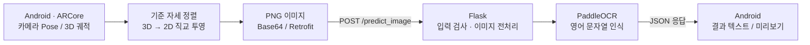

# Air Drawing — ARCore 기반 공중 필기 인식 시스템

**Android 스마트폰의 ARCore 카메라 Pose로 공중 필기 궤적을 수집하고, 이를 2차원 이미지로 직교 투영한 뒤 Flask/PaddleOCR로 문자를 인식하는 캡스톤 프로젝트입니다.**

휴대전화를 공중에서 움직이며 화면 터치로 획을 구분합니다. 3차원 위치 데이터는 기준 자세에 맞춰 회전·투영되고, 생성된 이미지가 Python 서버로 전송되어 인식 결과를 Android 화면에 표시합니다.

**[시연 영상 (YouTube Shorts)](https://www.youtube.com/shorts/3RjYSgrBuwM)** · **[캡스톤 논문 (PDF)](./논문_비전%20및%20관성%20센서%20융합을%20활용한%20직교%20투영%20기반%20딥러닝%20공중%20필기%20인식.pdf)** · **[상세 아키텍처](docs/architecture.md)** · **[검증 결과](docs/testing.md)**

> **검증 범위:** 실제 PaddleOCR CPU 추론과 Android 에뮬레이터 → Flask → PaddleOCR → 결과 화면 E2E 테스트를 통과했습니다. 다만 ARCore의 실제 공중 필기 동작 자체는 이 자동화 테스트에 포함되지 않으며, 원본 대규모 실험 데이터도 보유하고 있지 않습니다.

## Demo

- **[시연 영상 보기](https://www.youtube.com/shorts/3RjYSgrBuwM)** — 프로젝트 시연 자료
- **[논문 6페이지 그림 5·6](./논문_비전%20및%20관성%20센서%20융합을%20활용한%20직교%20투영%20기반%20딥러닝%20공중%20필기%20인식.pdf#page=6)** — 3D 공중 필기 궤적과 2D 투영 이미지
- **[논문 7페이지 그림 7](./논문_비전%20및%20관성%20센서%20융합을%20활용한%20직교%20투영%20기반%20딥러닝%20공중%20필기%20인식.pdf#page=7)** — 앱의 `hello` 인식 결과

논문에 삽입된 이미지는 PDF에서 추출된 자료이므로, 원본 앱 이미지와 완전히 같은 해상도·픽셀이라고 가정하지 않습니다.

## My Contributions — 담당 역할

**캡스톤 개발 당시 담당: Android 공중 필기 알고리즘 전반 · Python OCR 서버**

| 담당 영역 | 직접 수행한 주요 작업 |
| --- | --- |
| **위치 추적 설계** | 가속도·자이로센서만으로 위치를 적분하는 초기 접근의 누적 오차를 경험하고, 영상·관성 데이터를 함께 사용하는 ARCore 추적으로 설계를 전환 |
| **3D → 2D 투영 알고리즘** | PCA 기반 투영의 좌우 반전·상하 뒤집힘 문제를 분석하고, 사용자가 지정한 스마트폰 기준 자세에 따라 평행이동·회전·XY 투영하는 방식으로 재설계 |
| **공중 필기 처리** | 카메라 Pose의 3D 위치 수집, 터치 구간별 획 구분, 2D 렌더링·이미지 생성 흐름 구현 |
| **OCR 백엔드** | Flask API와 PaddleOCR 기반 이미지 전처리·인식·JSON 응답 파이프라인 구현 및 앱 연동 |

**이후 유지보수·포트폴리오 정리:** 기존 구현을 재점검하면서 민감정보·임시 데이터 처리 개선, 모델 의존성 및 반복 요청 문제 대응, 실제 PaddleOCR와 Android 계측 E2E 자동 테스트를 추가했습니다. 캡스톤 최초 개발과 이후 안정성 개선은 별도의 작업 시기로 구분합니다.

> 이 항목은 **본인이 담당했다고 확인한 영역**에 한정합니다. Android UI 전체나 팀원 담당 기능까지 개인 기여로 포괄하지 않습니다.

## Key Engineering Challenges & Decisions

### 1. 관성센서 기반 위치 추정의 누적 오차 → ARCore 채택

- **초기 접근:** 가속도·자이로센서만 사용하여 위치를 추정하려고 했습니다.
- **관찰한 문제:** 가속도 값의 적분 과정에서 노이즈·바이어스가 누적되어 실제 공중 필기 궤적이 드리프트했습니다.
- **선택과 구현:** 기기 카메라의 시각 정보와 관성 측정을 결합하는 **ARCore Motion Tracking**을 채택하고, 앱에서 제공받는 카메라 Pose를 3D 필기 입력으로 사용했습니다.
- **성과 및 한계:** 직접 적분으로 위치를 산출하던 초기 설계를 대체했습니다. 초기 방식 대비 수치화된 오차 개선율은 측정 자료가 없어 주장하지 않습니다.

### 2. PCA 투영의 방향 불안정성 → 기준 자세 기반 직교 투영

- **초기 접근:** 3D 필기 궤적에 PCA를 적용해 PC1·PC2를 2D 투영 축으로 사용했습니다.
- **관찰한 문제:** 필기 형태와 주성분의 상대적인 크기·방향에 따라 글자가 **좌우 반전되거나 뒤집히는 현상**이 발생했습니다. PCA 고유벡터의 부호 모호성과 데이터 의존적인 축 선택이 관련된 문제였습니다.
- **선택과 구현:** 궤적 데이터에서 투영 방향을 다시 계산하는 대신, **기준점 설정 시 카메라의 위치와 방향 축을 저장**하여 필기 좌표계의 방향을 정의했습니다. 이후 3D 점을 평행이동·회전하고 XY 성분으로 투영합니다.
- **성과 및 한계:** PCA 축 방향의 불확정성에 의존하지 않는 투영 구조를 구현했습니다. 다양한 글자에서의 개선율이나 원본 비교 이미지 데이터는 현재 재현할 수 없습니다.

**[투영 구현 코드 — TestProjector.java](android-app/app/src/main/java/com/nkm/ar/core/java/utils/projectors/TestProjector.java)** · **[ARCore Pose 수집 코드 — HelloArActivity.java](android-app/app/src/main/java/com/nkm/ar/core/java/views/HelloArActivity.java)** · **[설계 근거 및 수식](docs/architecture.md)**

### 3. OCR 서버의 안정성·보안 보완

- **모델 초기화 실패:** PaddleOCR/PaddleX 등 의존성의 호환 버전을 고정하여 실제 CPU 추론을 검증했습니다.
- **연속 OCR 요청 오류:** 후속 요청에서 관찰된 HTTP 500을 Flask 개발 서버의 직렬 요청 처리로 완화하고 연속 추론 및 Android E2E로 검증했습니다. 근본 동시성 원인을 완전히 규명했다고 주장하지 않습니다.
- **데이터·연결 보호:** 하드코딩된 ngrok 토큰 및 URL 제거, Android OCR 결과의 불필요한 영구 저장 제거, Debug/Release URL 정책 및 자동 테스트를 정리했습니다.

**[상세 장애·테스트 기록](docs/testing.md)**

## 시스템 구조



### 핵심 구현

1. **3D 궤적 수집:** ARCore 카메라의 월드 좌표와 방향 축을 사용합니다. 기준점을 지정한 뒤 화면의 필기 영역을 터치한 동안 위치를 수집하고, 터치 해제로 획 경계를 기록합니다.
2. **2D 직교 투영:** 기준 위치만큼 평행이동하고 기준 방향으로 회전한 후 XY 성분을 선택합니다. 투영 좌표를 선으로 연결해 필기 이미지를 생성합니다.
3. **이미지 전처리·인식:** Android가 PNG를 Base64로 인코딩해 Flask API에 전송합니다. 서버는 입력 형식·크기를 검사하고 글씨 영역을 크롭·정규화한 뒤 PaddleOCR로 영문을 인식합니다.
4. **결과 표시:** 인식 문자열과 이미지 미리보기를 Android 결과 화면에 표시합니다. 기본 설정에서는 OCR 텍스트와 서버 결과 이미지를 영구 보관하지 않습니다.

**기술 스택:** Java, Android, ARCore, Apache Commons Math, Retrofit, Python, Flask, Pillow, OpenCV, PaddlePaddle/PaddleOCR, GitHub Actions.

구체적인 좌표 변환 수식, Android–Flask 데이터 흐름, API 오류 상태, 데이터 보호 경계는 **[아키텍처 문서](docs/architecture.md)**를 참고하세요.

## 실제 검증 결과

| 테스트 | 결과 | 근거 |
| --- | --- | --- |
| 실제 PaddleOCR CPU 추론 | 합성 PNG `HELLO 123` → `HELLO 123` | [Actions](https://github.com/scr08212/air-drawing/actions/runs/42271598029) |
| 논문 필기 샘플 인식 | 그림 6의 `hello` → `hello` | [Actions](https://github.com/scr08212/air-drawing/actions/runs/42346382543) |
| Android–Flask–PaddleOCR E2E | 두 이미지 전송, 결과 화면과 미리보기 검사 | [Actions](https://github.com/scr08212/air-drawing/actions/runs/42346550527) |
| 데이터 보호와 서버 주소 정책 | Android 계측 테스트 **6개 성공**, Release의 비HTTPS URL 거부 | [Actions](https://github.com/scr08212/air-drawing/actions/runs/42351533788) |

이 표는 **특정 샘플에서의 실제 기능 검증**입니다. 두 이미지가 정확히 인식됐다고 해서 전체 OCR 정확도가 100%라는 의미는 아닙니다. 실험 원본 데이터가 없어 논문에 기록된 과거 전체 정확도와 응답 시간을 재측정하지 않았습니다.

기술적 문제 해결 이력(모델 의존성 충돌, 반복 요청 오류, ngrok 인증정보 관리, Android 데이터 잔존) 및 테스트 한계는 **[testing.md](docs/testing.md)**에 정리했습니다.

## 실행 방법 (개발 환경)

**준비물:** Python 3.11, 검증된 PaddleOCR CPU 의존성, Android Studio/SDK 및 Gradle, ARCore 지원 스마트폰(실제 공중 필기 시연 시).

1. 백엔드 개발 환경에 PaddlePaddle 3.1.0, PaddleOCR 3.1.0, PaddleX 3.1.1 등 **CI에서 사용한 호환 버전**을 설치합니다. 전체 설치 패키지는 [Android E2E CI 워크플로](.github/workflows/android-flask-e2e.yml)를 참고하세요. 최초 추론에서는 모델 파일 다운로드가 필요할 수 있습니다.
2. 저장소 루트에서 Flask 서버를 실행합니다.

   ```bash
   python python-backend/server/app.py
   ```

3. Android 에뮬레이터에서 접근할 경우 `android-app/` 폴더에서 다음을 실행합니다.

   ```bash
   ./gradlew :app:installDebug -PocrDebugBaseUrl=http://10.0.2.2:5000/
   ```

   Windows에서는 `gradlew.bat`를 사용합니다. 실제 스마트폰은 `10.0.2.2`를 사용할 수 없으므로 접근 가능한 개발 서버 주소를 별도로 지정해야 합니다.

**[Android 서버 주소 설정 가이드](docs/android-ocr-server-config.md)** — Debug/Release 구분, 로컬 연결, HTTPS 및 환경변수 설정을 상세히 설명합니다.

프로젝트에는 기본 외부 OCR 서버 주소나 공개 ngrok URL이 포함되어 있지 않습니다. 실제 공개 배포 서버도 제공하지 않습니다.

## 프로젝트 구조

```text
air-drawing/
├── android-app/                 # ARCore 위치 추적, 투영, 화면, Retrofit
│   └── app/src/androidTest/     # Android 계측·E2E 테스트
├── python-backend/
│   ├── server/app.py            # Flask /predict_image API
│   ├── model/                   # PaddleOCR 추론 및 이미지 전처리
│   └── tests/                   # API, 입력 검증, 실제 OCR 검증
├── .github/workflows/          # CI 및 Android 에뮬레이터 E2E
├── docs/
│   ├── architecture.md          # 구현 아키텍처·직교 투영·데이터 흐름
│   ├── testing.md               # 테스트 근거·장애 수정·미검증 영역
│   └── android-ocr-server-config.md
└── 논문_*.pdf                   # 원본 캡스톤 논문
```

## 설계 및 보안상 고려 사항

- **모델 가용성:** CPU 기본값, 실제 모델 테스트에 사용한 호환 의존성 버전 확인
- **입력 보호:** JSON/이미지 형식·크기 제한 및 내부 오류 메시지 은닉
- **데이터 보호:** OCR 문자열 영구 저장 제거, Android 미리보기 캐시의 1회 사용 후 삭제; 단, 사용자가 명시적으로 내보내는 3D 좌표 CSV는 Downloads에 남을 수 있음
- **네트워크:** Debug는 개발용 HTTP(S), Release는 HTTPS만 허용. 서버 URL은 빌드 시 명시하며 인증 토큰을 포함하지 않음
- **현재 범위:** Flask 개발 서버를 사용하며, 프로덕션 인증·요청 제한·고가용성·클라우드 배포는 구현 및 검증 범위 밖

## 자료 출처 및 작업 범위

기초 설계, 캡스톤 개발 당시의 알고리즘과 실험 서술은 [논문 원문](./논문_비전%20및%20관성%20센서%20융합을%20활용한%20직교%20투영%20기반%20딥러닝%20공중%20필기%20인식.pdf)을 참고하세요. 본인 담당 영역과 이후 유지보수 작업은 위 **My Contributions**에서 구분했습니다. 과거 IMU·PCA 설계 시도는 개발 과정에 대한 회고이며, 최신 코드와 CI가 해당 초기 구현까지 재현한다는 의미는 아닙니다.

상세 구현: [Architecture](docs/architecture.md) · 검증 및 한계: [Testing](docs/testing.md) · 시연: [YouTube](https://www.youtube.com/shorts/3RjYSgrBuwM)
