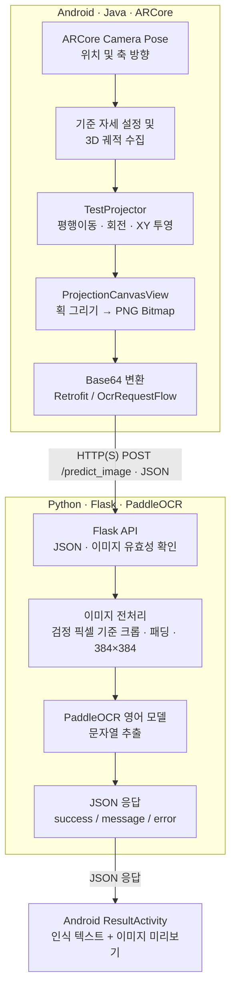
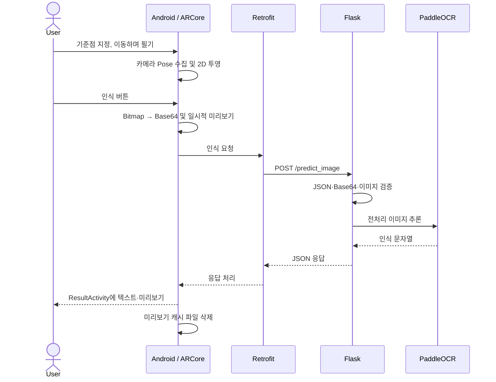

# Architecture — Air Drawing

> 이 문서는 **2026-11-07 기준 저장소 `main`의 구현과 GitHub Actions 검증 범위**를 설명합니다. 논문에서 제시한 개념과 실제 코드의 동작이 다른 경우 **코드를 우선**합니다. 공개 클라우드 배포 아키텍처를 설명하는 문서가 아닙니다.

## 1. 시스템의 역할과 경계

Air Drawing은 **스마트폰을 공중에서 움직여 기록한 ARCore 카메라 Pose(위치·자세)**를 2D 필기 이미지로 변환하고, Python Flask 서버의 PaddleOCR가 인식한 텍스트를 Android 화면에 표시하는 시스템입니다. 손가락 끝의 3D 위치를 별도의 비전 모델로 추적하는 구성은 아닙니다. 화면 터치 상태는 궤적 기록 구간과 획 분리에 사용됩니다.



- **Android:** [`HelloArActivity.java`](../android-app/app/src/main/java/com/nkm/ar/core/java/views/HelloArActivity.java), [`TestProjector.java`](../android-app/app/src/main/java/com/nkm/ar/core/java/utils/projectors/TestProjector.java), [`ProjectionCanvasView.java`](../android-app/app/src/main/java/com/nkm/ar/core/java/views/ProjectionCanvasView.java)
- **통신:** [`OcrRequestFlow.java`](../android-app/app/src/main/java/com/nkm/ar/core/java/network/OcrRequestFlow.java), [`RetrofitClient.java`](../android-app/app/src/main/java/com/nkm/ar/core/java/network/RetrofitClient.java)
- **서버:** [`app.py`](../python-backend/server/app.py), [`paddleOCR.py`](../python-backend/model/paddleOCR.py), [`utils.py`](../python-backend/model/utils.py)

## 2. 공중 필기와 좌표 투영

### 2.1 입력 수집

1. 사용자가 **기준점 설정**을 누르면 해당 프레임의 ARCore 카메라 월드 좌표 `(tx, ty, tz)`를 원점 `origin`으로 기록합니다.
2. 카메라 Pose의 X·Z 축으로부터 기준 방향 `originRight`, `originDir`을 계산합니다. 현재 구현은 각 축에 음수 부호를 적용합니다.
3. 화면의 필기 영역을 터치 중이고 기준점이 존재하면 **카메라 이동 위치**를 3차원 점으로 추가합니다. 매우 가까운 연속 위치는 거리 제곱의 임계값 `0.00001`을 기준으로 건너뜁니다.
4. 터치를 떼면 획 경계 인덱스(`breakPoints`)를 기록해 다음 획과 연결되지 않게 합니다.

이는 **휴대전화를 공중에서 움직이면서 터치로 필기 구간을 제어**하는 방식입니다. ARCore가 제공하는 카메라 추정 Pose에는 기기 센서와 비전 추적의 결과가 반영됩니다.

### 2.2 3D → 2D 직교 투영

[`TestProjector.project(...)`](../android-app/app/src/main/java/com/nkm/ar/core/java/utils/projectors/TestProjector.java)은 세 단계로 동작합니다.

1. 원점 이동: 각 점 `p`에서 기준 위치 `o`를 뺍니다.
2. 기준 축 정렬: `originDir` 및 `originRight`로 정의한 회전 `R`을 적용합니다.
3. XY 성분만 선택해 `PointF`로 반환합니다. 깊이(Z) 성분은 결과 좌표에 포함하지 않습니다.

```math
q = R(p-o), \qquad (u,v)=(q_x,q_y)
```

이 표기는 **구현의 처리 순서를 요약한 수식**입니다. 실제 축 정렬은 Apache Commons Math `Rotation(Vector3D.PLUS_J, Vector3D.PLUS_K, normalizedDir, originRightVec)` 호출로 정의됩니다. 논문의 좌표계·수식과 비교할 때 축 부호 및 회전 방향을 별도로 확인해야 합니다.

### 2.3 Bitmap 생성

[`ProjectionCanvasView`](../android-app/app/src/main/java/com/nkm/ar/core/java/views/ProjectionCanvasView.java)는 2D 점들의 범위를 기준으로 전체 획을 중앙 정렬하고, 가로·세로 비율이 유지되도록 스케일을 조정합니다. `breakPoints`에서는 선을 잇지 않습니다. 검은 선을 흰 배경에 렌더링한 결과를 Bitmap으로 추출하여 PNG/Base64로 전송합니다.

**중요:** 필기 영역의 실제 콘텐츠 크롭과 384×384 정규화는 Android가 아니라 **Flask 쪽 `model/utils.py`**에서 수행합니다.

## 2.4. 개발 중 설계 변경의 근거 (개발자 회고)

최종 코드가 현재 구조를 선택하게 된 배경에는 두 차례의 설계 변경이 있었습니다. **아래 초기 방식은 개발 당시 시도·관찰한 내용으로, 현재 저장소의 테스트가 초기 프로토타입까지 재현한다는 뜻이 아닙니다.**

| 항목 | 초기 접근 | 관찰한 제약 | 최종 선택 |
| --- | --- | --- | --- |
| 3D 위치 추적 | 가속도·자이로센서만으로 추정·적분 | 적분 오차가 누적되어 필기 궤적이 드리프트함 | ARCore Motion Tracking에서 제공되는 카메라 Pose 사용 |
| 2D 투영 평면 | PCA의 PC1·PC2를 주축으로 사용 | 필기 분포에 따라 좌우·상하 방향이 불안정하고 반전·뒤집힘 현상이 발생함 | 사용자가 지정한 카메라 기준 위치·방향으로 회전·직교 투영 |

### 관성센서만으로 위치를 구하지 않은 이유

가속도 적분으로 속도·위치를 구할 때는 센서 바이어스와 노이즈가 누적될 수 있습니다. 프로젝트에서는 초기 방식에서 필기 좌표의 누적 오차를 관찰했고, 카메라 영상의 시각 정보와 관성 측정을 함께 이용하는 **ARCore의 카메라 Pose 추정**으로 입력 방식을 변경했습니다. 현재 구현은 별도 손끝 추적이나 직접적인 IMU 이중 적분을 수행하지 않습니다.

### PCA를 투영 기준축으로 사용하지 않은 이유

PCA의 주성분 고유벡터는 **부호가 유일하지 않으며**, 데이터의 분산 특성이 바뀌면 선택되는 축의 상대적 우선순위도 달라집니다. 개발 당시 필기 궤적의 형태에 따라 문자 좌우 반전·상하 뒤집힘이 발생했습니다. 따라서 **필기된 데이터로부터 매번 축을 정의하는 방식** 대신, 기준점 버튼을 누른 순간의 스마트폰 자세로 좌표계를 정의했습니다. 이 결정은 축 방향을 입력 분포가 아니라 사용자의 기준 자세에 종속시킨다는 점에서 차이가 있습니다.

단, PCA 대비 정량적 오류 감소량이나 초기 실험의 재현 자료는 현재 확보되지 않았습니다. 현재 최종 투영 코드는 위의 [2.2 절](#22-3d--2d-직교-투영) 및 `TestProjector.java`에서 확인할 수 있습니다.

## 3. HTTP 요청·응답 계약

Android는 [`OcrService.java`](../android-app/app/src/main/java/com/nkm/ar/core/java/network/OcrService.java)를 통해 다음 요청을 보냅니다.

```http
POST /predict_image
Content-Type: application/json
```

```json
{
  "image_base64": "<PNG 이미지의 Base64 문자열>"
}
```

인식 성공 시 응답 예:

```json
{
  "success": true,
  "message": "hello",
  "error": ""
}
```

오류 상태는 현재 Flask 코드 기준으로 다음과 같이 처리합니다.

| HTTP 상태 | 의미 |
| --- | --- |
| `200` | OCR 인식 성공 |
| `400` | 잘못된 JSON, 필수 이미지 데이터 누락·오류, 또는 문자 미검출 |
| `413` | 요청 본문·이미지 크기 제한 초과 |
| `500` | 예기치 못한 추론 오류 |
| `503` | OCR 모델 초기화 불가 |

일부 `400` 응답에는 `message` 필드가 없을 수 있습니다. 성공 응답 스키마 외에 `confidence` 등 별도 신뢰도 수치를 **현재 서버가 항상 반환한다고 가정하지 않습니다.** Android는 통신 오류나 인식 실패를 민감정보가 없는 안내 문구로 처리합니다.

## 4. Flask 입력 검증 및 PaddleOCR 처리

[`app.py`](../python-backend/server/app.py)는 JSON 객체와 `image_base64` 존재 여부를 확인하고 요청 본문 최대 크기를 **8MiB**로 제한합니다. [`paddleOCR.py`](../python-backend/model/paddleOCR.py)는 추가로 다음을 검사합니다.

- 인코딩: 올바른 Base64 문자열
- 이미지 형식: PNG, JPEG 또는 WebP
- 디코딩한 파일 크기: **5MiB 이하**
- 이미지 해상도: **1,200만 픽셀 이하**

전처리([`model/utils.py`](../python-backend/model/utils.py))는 회색조 변환 → 밝기 임계값(`< 240`)으로 글씨 영역 탐지 → 여백을 둔 크롭(`pad_ratio=0.2`) → 종횡비 유지 리사이즈 → 흰색 **384×384** 캔버스 중앙 배치로 진행합니다. 그다음 PaddleOCR 영어 모델의 `rec_texts`를 결합합니다.

기본 장치는 `OCR_DEVICE=cpu`입니다. 서버는 OCR 모델을 처음 사용할 때 지연 초기화하며, 현재 Flask 개발 서버는 `threaded=False`로 요청을 직렬 처리합니다. 과거 동일 서버에서 여러 요청을 처리할 때 오류가 관찰된 뒤 적용한 설정입니다. **멀티스레드 근본 원인이 완전히 규명됐거나 운영 환경의 동시 처리까지 검증됐다는 의미는 아닙니다.**

## 5. 데이터 저장과 보안 경계

| 위치 | 현재 정책 |
| --- | --- |
| Android OCR 텍스트 | 결과 화면에서 사용하며 새로 `SharedPreferences`에 저장하지 않음 |
| Android 이미지 미리보기 | 앱 전용 캐시에 생성하고 결과 화면에서 읽은 뒤 파일 삭제 |
| 오래된 앱의 OCR 저장 값 | 앱 시작·결과 화면 진입 시 관련 설정과 고정 파일명 캐시 정리 |
| Flask OCR 이미지/텍스트 | 기본적으로 서버 디스크에 저장하지 않음. `OCR_SAVE_RESULTS_DIR`를 지정한 경우에만 선택적 저장 |
| 사용자가 내보낸 좌표 CSV | **예외:** 명시적인 내보내기 조작으로 공용 Downloads 폴더에 영구 보존될 수 있음 |

- 네트워크 Base64 본문과 OCR 인식 문자열을 일반 애플리케이션 로그로 남기지 않도록 수정했습니다.
- Android **Debug** 빌드만 로컬 테스트용 HTTP를 허용합니다. **Release** 빌드의 OCR 주소는 HTTPS만 허용합니다.
- 기본 원격 서버 URL을 APK에 넣지 않았습니다. 서버 주소는 빌드 시 명시합니다. [설정 가이드](android-ocr-server-config.md)
- ngrok은 환경변수를 통한 **선택적 터널링**이며 API 인증을 제공하지 않습니다. 서버를 공용 인터넷에 노출하려면 인증, 요청 제한 및 운영용 서버 구성 등이 필요합니다.
- 파일 삭제는 일반적인 캐시 정리이지 저장장치 수준의 보안 삭제를 보장하지 않습니다.

## 6. 처리 순서 — 시퀀스



## 7. 참고 자료와 검증 범위

- [시연 영상 — YouTube Shorts](https://www.youtube.com/shorts/3RjYSgrBuwM)
- [캡스톤 논문 원문](../논문_비전%20및%20관성%20센서%20융합을%20활용한%20직교%20투영%20기반%20딥러닝%20공중%20필기%20인식.pdf) — 3D 궤적·2D 투영 이미지 및 인식 화면은 논문의 그림 참조
- [테스트 결과 및 한계](testing.md) — 실제 PaddleOCR CPU, Android 에뮬레이터 E2E, 입력 검증 및 데이터 보호
- [서버 주소 및 실행 환경 설정](android-ocr-server-config.md)

### 명시적인 한계

1. **원본 대규모 실험 데이터가 없어** 논문에 기록된 과거 인식률과 처리 시간을 재현하지 않았습니다.
2. Android CI는 **준비된 이미지의 전송부터 결과 화면 표시까지** 검증합니다. 실제 스마트폰에서의 ARCore 공중 필기 동작을 자동 검증하지는 않습니다. 논문의 데모·서술과 CI 검증 범위는 구분해야 합니다.
3. `KalmanFilter.java`가 존재하지만 현재 주된 필기 경로에서 호출되는 것은 확인되지 않았으므로, 실시간 칼만 필터 보정을 적용했다고 기록하지 않습니다.
4. 클라우드 서비스, 프로덕션 인증·오토스케일링·운영 모니터링이 배포됐다는 주장은 하지 않습니다.
