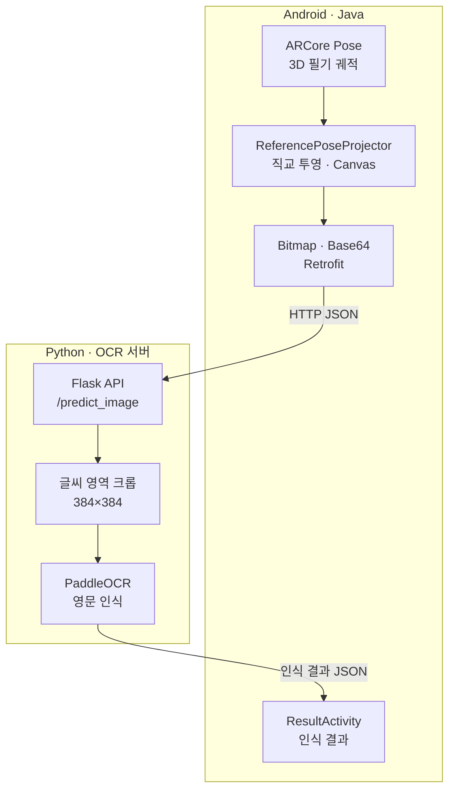
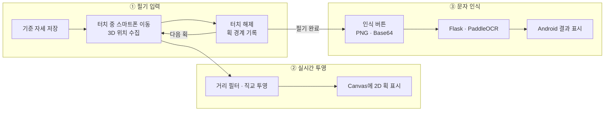
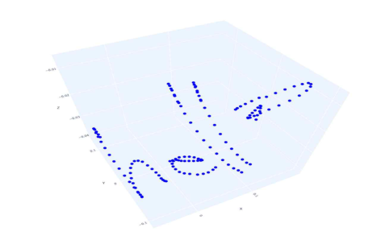
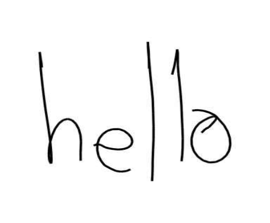
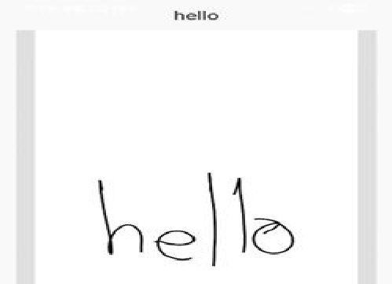

# Architecture | Air Drawing

> 이 문서는 **2025년 Air Drawing 캡스톤 프로젝트**에서 구현한 공중 필기 입력, 3D→2D 직교 투영, 이미지 처리 및 OCR 연동 구조를 설명합니다. 프로젝트 개요·개인 기여·인식 실험 결과는 [README](../README.md)와 [캡스톤 논문](../논문_비전%20및%20관성%20센서%20융합을%20활용한%20직교%20투영%20기반%20딥러닝%20공중%20필기%20인식.pdf)을 참고하세요.

## 1. System Overview

Air Drawing은 **스마트폰 자체의 이동**을 필기 입력으로 사용하는 Android–Python 시스템입니다. ARCore가 추정한 스마트폰 카메라의 위치·방향을 이용해 3D 궤적을 수집하고, 사용자가 설정한 기준 자세에 따라 2D 필기 이미지로 투영합니다. 생성한 이미지를 Flask 서버에 전달하면 PaddleOCR가 문자를 인식해 Android로 반환합니다. **손가락 끝을 카메라로 추적하는 방식은 아닙니다.**



| 구성 요소 | 구현 책임 | 실제 소스 |
| --- | --- | --- |
| `AirWritingActivity` | ARCore 프레임 처리, 기준 자세, 3D 궤적·획 경계 수집 | [Java](../android-app/app/src/main/java/com/nkm/ar/core/java/views/AirWritingActivity.java) |
| `ReferencePoseProjector` | 기준 위치를 뺀 뒤 회전을 적용해 2D 점 생성 | [Java](../android-app/app/src/main/java/com/nkm/ar/core/java/utils/projectors/ReferencePoseProjector.java) |
| `ProjectionCanvasView` | 2D 획의 크기 조정·렌더링 및 Bitmap 생성 | [Java](../android-app/app/src/main/java/com/nkm/ar/core/java/views/ProjectionCanvasView.java) |
| `OcrService` / `RetrofitClient` | OCR HTTP 요청 정의 및 전송 | [API 인터페이스](../android-app/app/src/main/java/com/nkm/ar/core/java/network/OcrService.java) · [클라이언트](../android-app/app/src/main/java/com/nkm/ar/core/java/network/RetrofitClient.java) |
| `server/app.py` | Flask 엔드포인트와 JSON 응답 | [Python](../python-backend/server/app.py) |
| `model/utils.py` / `model/paddleOCR.py` | 이미지 전처리와 PaddleOCR 추론 | [전처리](../python-backend/model/utils.py) · [OCR](../python-backend/model/paddleOCR.py) |

## 2. Air Writing Workflow

사용자는 먼저 기준점을 설정합니다. 화면을 터치한 상태에서 **스마트폰을 이동**하면 ARCore 카메라 위치가 필기 데이터로 기록됩니다. 손을 떼면 획이 종료되며, 모든 필기가 끝난 뒤 별도의 **인식 버튼**으로 OCR 요청을 수행합니다.



좌표 수집과 2D 미리보기는 ARCore 프레임 갱신 중 이루어집니다. **터치 해제 자체가 OCR 호출 조건은 아니며**, 인식 버튼을 누를 때 현재 Canvas 이미지를 전송합니다.

## 3. 3D Motion Tracking

### 3.1. ARCore Camera Pose

Android의 `AirWritingActivity`는 ARCore `Session`에서 `Frame`과 `Camera`를 획득하고 `camera.getPose()`를 읽습니다. 필기 기록에는 Pose의 회전 자체가 아니라 매 프레임의 **카메라 위치**인 `tx()`, `ty()`, `tz()`를 사용하며, 기준 자세를 설정할 때에는 방향 축도 함께 읽습니다.

- **추적 입력:** ARCore가 제공하는 카메라 Pose
- **필기 좌표:** ARCore 월드 좌표계의 카메라 위치 `(x, y, z)`
- **기록 조건:** 기준 자세가 설정되어 있고 화면을 터치 중일 때

ARCore의 시각·관성 융합 기반 추적 기능을 **활용**한 것이며, ARCore 내부의 위치 추정/SLAM 알고리즘을 직접 구현한 것은 아닙니다.

### 3.2. Reference Pose

기준점 설정 버튼은 `setOriginRequested`를 활성화하며, 이후 카메라 프레임 처리 시점의 Pose에서 다음 값을 저장합니다.

```java
origin = new Point3F(pos.tx(), pos.ty(), pos.tz());
float[] zAxis = pos.getZAxis();
float[] xAxis = pos.getXAxis();
originDir = new Point3F(-zAxis[0], -zAxis[1], -zAxis[2]);
originRight = new Point3F(-xAxis[0], -xAxis[1], -xAxis[2]);
```

| 변수 | 의미 |
| --- | --- |
| `origin` | 투영에서 사용할 기준 위치 |
| `originDir` | 기준 카메라 Z축의 음수 방향 벡터 |
| `originRight` | 기준 카메라 X축의 음수 방향 벡터 |

이 세 값을 `ReferencePoseProjector.project()`의 인자로 전달합니다. 투영 방향은 전체 필기 데이터의 분포가 아니라 **기준점을 설정할 당시의 카메라 자세**로 정해집니다.

### 3.3. Trajectory Sampling

터치 중 수집하는 연속 좌표에는 거리 필터를 적용합니다. 직전에 저장한 점을 $\mathbf p_{prev}$, 현재 카메라 위치를 $\mathbf p$라고 하면 다음과 같습니다.

$$
d^2=(x-x_{prev})^2+(y-y_{prev})^2+(z-z_{prev})^2
$$

`AirWritingActivity`는 $d^2 \geq 0.00001$일 때 현재 점을 `points`에 추가하고 전체 점을 다시 투영합니다. 좌표 단위를 미터로 보면 연속 저장 점 사이 약 **3.16mm**에 해당하는 거리 기준입니다. 첫 번째 점은 이전 점이 없어 별도 거리 계산 없이 추가됩니다.

```java
if (distance >= 0.00001f) {
    points.add(new Point3F(tx, ty, tz));
    projectedPoints = ReferencePoseProjector.project(points, origin, originDir, originRight);
}
```

이 값은 별도의 시간 간격을 설정하는 **고정 주기 샘플링**이 아니라, 연속적인 위치 변화가 지나치게 작을 때 중복 저장을 줄이기 위한 **거리 기준**입니다.

### 3.4. Stroke Segmentation

터치의 `ACTION_DOWN`/`ACTION_MOVE`에서는 필기 상태를 활성화하고, `ACTION_UP`/`ACTION_CANCEL`에서는 필기를 종료합니다. 획이 끝나면 `breakPoints`에 현재 점 개수를 기록하여 **다음 획의 첫 점과 이전 획의 마지막 점을 연결하지 않도록** 합니다.

이후 `ProjectionCanvasView`는 해당 인덱스에서 선 그리기를 건너뜁니다. 따라서 한 글자 안에 여러 번 펜을 떼는 동작도 하나의 연속된 3D 선으로 잘못 연결되지 않습니다.

근거: [AirWritingActivity.java](../android-app/app/src/main/java/com/nkm/ar/core/java/views/AirWritingActivity.java) · [ProjectionCanvasView.java](../android-app/app/src/main/java/com/nkm/ar/core/java/views/ProjectionCanvasView.java)

## 4. Orthographic Projection

### 4.1. Coordinate Systems

투영 함수는 다음 값을 입력받습니다.

| 기호·변수 | 의미 |
| --- | --- |
| $\mathbf p=(x,y,z)$ | ARCore 월드 좌표계에서 수집한 필기 위치 |
| $\mathbf o$ / `origin` | 기준점 설정 시 저장한 카메라 위치 |
| `originDir`, `originRight` | 기준 자세에서 얻은 방향 벡터 |
| $R$ / `rotation` | 두 기준 벡터를 이용해 코드에서 생성한 3D 회전 |
| $(u,v)$ | 렌더링에 전달하는 최종 2D 좌표 |

여기서 $R$은 아래 Java 생성자로 정의한 회전입니다. 이를 근거 없이 카메라의 원래 회전 행렬이나 그 전치 행렬과 동일시하지 않습니다.

### 4.2. Translation

먼저 기준 위치를 빼서 상대 좌표를 계산합니다.

$$
\mathbf p_{rel}=\mathbf p-\mathbf o
$$

이 연산으로 월드 좌표의 절대 위치보다 **기준점에서 얼마나 이동했는지**를 투영 입력으로 사용할 수 있습니다.

### 4.3. Rotation

`ReferencePoseProjector.java`는 Apache Commons Math의 `Rotation` 생성자에 두 쌍의 방향 벡터를 전달하고, 그 회전을 상대 좌표에 적용합니다.

```java
Vector3D normalizedDir = originDirVec.normalize();
Rotation rotation = new Rotation(
    Vector3D.PLUS_J, Vector3D.PLUS_K,
    normalizedDir, originRightVec
);
Vector3D rotatedVec = rotation.applyTo(transformedVec);
```

첫 번째 벡터 쌍은 `PLUS_J`, `PLUS_K`이고 두 번째 쌍은 기준 자세에서 구성한 방향 벡터입니다. **축의 대응 순서와 부호가 결과에 영향을 주므로**, 실제 구현을 설명할 때 이 생성자와 `applyTo()`의 연산 순서를 유지합니다.

### 4.4. Orthographic Projection

회전 결과를 $\mathbf q$라고 하면 실제 처리 순서는 다음처럼 요약할 수 있습니다.

$$
\mathbf q=R(\mathbf p-\mathbf o),\qquad (u,v)=(q_x,q_y)
$$

```java
Vector3D transformedVec = new Vector3D(
    point3D.x, point3D.y, point3D.z
).subtract(originVec);
Vector3D rotatedVec = rotation.applyTo(transformedVec);
projectedPoints.add(new PointF(
    (float) rotatedVec.getX(), (float) rotatedVec.getY()
));
```

출력에서는 회전된 점의 X·Y만 사용하고 Z 성분은 버립니다. 이것이 이후 Android Canvas에서 사용할 **2차원 필기 궤적**입니다. 회전과 2D 투영의 세부 구현은 [ReferencePoseProjector.java](../android-app/app/src/main/java/com/nkm/ar/core/java/utils/projectors/ReferencePoseProjector.java)에서 확인할 수 있습니다.

### 4.5. Projection Result

2025년 캡스톤 논문에 수록된 실제 시연 자료입니다.

| ARCore 3D 필기 궤적 | 직교 투영된 2D 필기 |
| :---: | :---: |
|  |  |
| 논문 그림 5 | 논문 그림 6 |

기준 자세에 따른 좌표 변환으로 3D 이동 궤적을 OCR가 처리할 수 있는 2D 문자 형태로 표현했습니다. 화면에서 문자의 크기·위치를 맞추는 작업은 다음 단계의 Canvas 렌더링이 담당합니다.

## 5. Handwriting Image Processing

### 5.1. Android Canvas Rendering

`ProjectionCanvasView`는 투영된 2D 점들의 최소·최대 좌표로 데이터 범위를 구하고, Canvas 크기와 데이터 크기를 비교하여 **가로·세로에 공통 배율**을 적용합니다.

$$
s=0.6\min\left(\frac{W_{canvas}}{W_{data}},\frac{H_{canvas}}{H_{data}}\right)
$$

가로·세로 데이터 범위가 모두 0보다 클 때 적용되는 식입니다. 한쪽 범위가 0이거나 점이 하나인 경우에는 별도 처리를 수행합니다. `0.6`은 획이 화면 경계까지 꽉 차지 않도록 여백을 확보하는 계수입니다.

```java
float x = (p.x - dataCenterX) * scale + centerX;
float y = centerY + (p.y - dataCenterY) * scale;
return new PointF(x, y);
```

캔버스는 흰색으로 채우고 검은색 선을 그립니다. `breakPoints`에 해당하는 위치에서는 선을 연결하지 않습니다. 필기 중에는 빨간색 커서로 현재 투영 위치를 표시할 수도 있습니다.

### 5.2. Bitmap → PNG / Base64

인식 버튼을 누르면 `ProjectionCanvasView.getBitmap()`으로 현재 화면의 필기 이미지를 생성합니다. Android는 이 Bitmap을 **PNG로 압축한 뒤 Base64 문자열로 인코딩**하여 요청 데이터에 담습니다.

```java
ByteArrayOutputStream baos = new ByteArrayOutputStream();
bmp.compress(Bitmap.CompressFormat.PNG, 100, baos);
return Base64.encodeToString(baos.toByteArray(), Base64.NO_WRAP);
```

이 단계에서 Android는 필기 이미지를 생성하지만, 아래에서 설명할 **글씨 영역 검출과 384×384 정규화는 Python 서버**에서 수행합니다.

### 5.3. Python Image Preprocessing

서버의 `preprocess()`는 OCR에 입력할 이미지를 다음 순서로 가공합니다.

1. 이미지의 회색조 변환
2. 픽셀 밝기가 **240 미만**인 영역을 검출하여 글씨의 최소 바운딩 박스 계산
3. 글씨 영역 너비·높이의 **20%**에 해당하는 여백을 더해 크롭(원본 이미지 경계 내)
4. 종횡비를 유지하며 리사이즈
5. 흰색 **384×384** 캔버스의 중앙에 배치

아래는 **글씨 영역을 크롭한 이후의 리사이즈·중앙 배치 연산**을 발췌한 것입니다. `cropped`는 앞 단계에서 여백을 포함해 잘라낸 PIL 이미지이며, `size`의 기본값은 `384`입니다.

```python
cropped_w, cropped_h = cropped.size
scale = min(size / cropped_w, size / cropped_h)
new_w = int(cropped_w * scale)
new_h = int(cropped_h * scale)
resized = cropped.resize((new_w, new_h), Image.LANCZOS)
background = Image.new("RGB", (size, size), color=(255, 255, 255))
offset_x = (size - new_w) // 2
offset_y = (size - new_h) // 2
background.paste(resized, (offset_x, offset_y))
```

밝기 임계값은 **크롭 영역을 검출하는 데 사용**합니다. OCR 입력 전체를 단순 흑백 이진 이미지로 바꾼다는 뜻은 아닙니다. 글씨가 전혀 검출되지 않으면 흰색 384×384 이미지를 반환합니다.

근거: [ProjectionCanvasView.java](../android-app/app/src/main/java/com/nkm/ar/core/java/views/ProjectionCanvasView.java) · [model/utils.py](../python-backend/model/utils.py)

## 6. Flask & PaddleOCR Pipeline

### 6.1. HTTP API

Android의 Retrofit 인터페이스는 `POST /predict_image` 엔드포인트로 JSON을 전송합니다.

**요청 형식**

```json
{
  "image_base64": "<PNG Base64 문자열>"
}
```

**성공 응답 예시**

```json
{
  "success": true,
  "message": "hello",
  "error": ""
}
```

`success`는 인식 성공 여부, `message`는 인식 문자열, `error`는 오류 정보를 나타냅니다. 요청 오류에서는 응답 필드 구성이 다를 수 있으며, 신뢰도 점수는 이 API가 기본적으로 반환하는 값이 아닙니다.

근거: [OcrService.java](../android-app/app/src/main/java/com/nkm/ar/core/java/network/OcrService.java) · [server/app.py](../python-backend/server/app.py)

### 6.2. OCR Inference

Flask는 `image_base64`를 추출해 OCR 처리 함수에 전달합니다. 백엔드는 Base64를 디코딩하고 Pillow 이미지로 변환한 다음, 앞서 설명한 `preprocess()` 결과를 OpenCV 형식으로 바꾸어 PaddleOCR에 입력합니다.

```python
preprocessed_image = preprocess(raw_image)
np_image = cv2.cvtColor(np.asarray(preprocessed_image), cv2.COLOR_RGB2BGR)
predictions = _get_ocr().predict(np_image)
texts = predictions[0].get('rec_texts', [])
recognized_text = ' '.join(text for text in texts if isinstance(text, str)).strip()
```

프로젝트는 **PaddleOCR 영문 모델**을 사용합니다. 인식된 텍스트는 JSON의 `message`로 반환되며, Android는 해당 문자열을 결과 화면으로 전달합니다.

### 6.3. Recognition Result

Android 결과 화면에서는 인식 문자열과 필기 이미지를 함께 보여줍니다. 아래 이미지는 2025년 캡스톤 논문에 수록된 `hello` 인식 결과입니다.



*논문 그림 7 — 투영된 필기 이미지의 영문 `hello` 인식 결과.*

현재 저장소의 요청·결과 표시 흐름은 [OcrRequestFlow.java](../android-app/app/src/main/java/com/nkm/ar/core/java/network/OcrRequestFlow.java)와 [ResultActivity.java](../android-app/app/src/main/java/com/nkm/ar/core/java/views/ResultActivity.java)에서 확인할 수 있습니다.

## 7. Engineering Decisions

### 7.1. IMU-based Position Estimation → ARCore

**초기 접근:** 가속도·자이로센서 값을 이용해 스마트폰 이동 위치를 직접 추정하려고 했습니다.

**문제:** 가속도를 적분해 속도와 위치를 계산할 때 작은 센서 오차가 누적되면서 필기 궤적이 드리프트하는 문제가 발생했습니다.

**선택:** 센서값으로 위치를 직접 적분하는 방식 대신, 카메라 영상과 관성 정보를 융합하는 **ARCore Motion Tracking이 제공하는 카메라 Pose**를 사용했습니다.

**설계상 의미:** 위치 추정은 ARCore에 맡기고, 직접 구현한 **공중 필기 입력·투영 로직**에 집중할 수 있었습니다.

### 7.2. PCA-based Projection → Reference-pose Projection

**초기 접근:** 3D 좌표 분포의 주요 방향을 나타내는 PCA의 두 주성분을 2D 투영 축으로 활용했습니다.

**문제:** 필기 궤적의 분포에 따라 문자 방향이 회전하거나 좌우가 반전되는 현상을 경험했습니다. 데이터에서 새로 계산한 축만으로는 사용자가 기대하는 글씨 방향을 일관되게 정의하기 어려웠습니다.

**선택:** 사용자가 기준점을 지정할 때 얻은 **카메라 위치·방향**을 기준으로 회전을 구성하고, 그 결과의 XY 성분을 사용하는 직교 투영으로 변경했습니다.

**설계상 의미:** 필기 방향의 기준을 궤적의 분산이 아닌 **사용자가 설정한 자세**에 두었습니다. 실제 투영 결과는 논문 그림 5·6에서 확인할 수 있습니다.

두 설계 변경은 **2025년 캡스톤 개발 과정**의 주요 기술적 의사결정입니다. 수치화된 방식 간 성능 개선율 대신, 발생한 문제와 코드에 반영한 해결 방법을 중심으로 설명했습니다.

## 8. References

- [Air Drawing README](../README.md) — 프로젝트 개요, 개인 기여, 실제 시연 및 논문 인식 실험 결과
- [캡스톤 논문](../논문_비전%20및%20관성%20센서%20융합을%20%ED%99%9C%EC%9A%A9%ED%95%9C%20%EC%A7%81%EA%B5%90%20%ED%88%AC%EC%98%81%20%EA%B8%B0%EB%B0%98%20%EB%94%A5%EB%9F%AC%EB%8B%9D%20%EA%B3%B5%EC%A4%91%20%ED%95%84%EA%B8%B0%20%EC%9D%B8%EC%8B%9D.pdf) — 3D 궤적·2D 투영·인식 화면과 연구 결과
- [Android OCR 서버 연결 안내](android-ocr-server-config.md) — 실제 실행 환경의 서버 주소 설정
- [Google ARCore Pose API](https://developers.google.com/ar/reference/java/com/google/ar/core/Pose)
- [Apache Commons Math Rotation API](https://commons.apache.org/proper/commons-math/javadocs/api-3.6.1/org/apache/commons/math3/geometry/euclidean/threed/Rotation.html)
- [PaddleOCR](https://github.com/PaddlePaddle/PaddleOCR)

Android의 AR 렌더링·앱 골격 일부는 Google ARCore 샘플 코드를 기반으로 하며 해당 소스의 저작권·라이선스 고지를 유지합니다. 이 문서가 집중하는 기술 구현 범위는 [README의 개인 담당 영역](../README.md#project-overview--my-role)에 정리되어 있습니다.