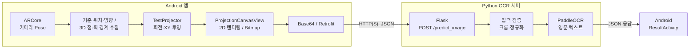

# Architecture | Air Drawing

> **문서 목적:** 현재 저장소의 실제 구현을 기준으로 Android 공중 필기 → 2D 이미지 → Flask/PaddleOCR 인식 흐름을 설명합니다. 개발 당시의 설계 변경 이력은 별도로 표시합니다.

## 1. 시스템 개요

Air Drawing은 **스마트폰 자체를 공중에서 움직여 얻은 ARCore 카메라 Pose**를 사용합니다. 손가락 끝을 별도로 인식하는 시스템이 아니며, 화면 터치는 **필기 기록 중인지와 획의 시작·종료**를 제어합니다.



| 모듈 | 역할 | 코드 |
| --- | --- | --- |
| `HelloArActivity` | ARCore 카메라 Pose·기준 자세·필기 데이터 수집 | [Android](../android-app/app/src/main/java/com/nkm/ar/core/java/views/HelloArActivity.java) |
| `TestProjector` | 원점 이동, 회전 적용, 2D 좌표 반환 | [Java](../android-app/app/src/main/java/com/nkm/ar/core/java/utils/projectors/TestProjector.java) |
| `ProjectionCanvasView` | 2D 점·획 경계를 선과 Bitmap으로 렌더링 | [Java](../android-app/app/src/main/java/com/nkm/ar/core/java/views/ProjectionCanvasView.java) |
| `OcrRequestFlow` / `RetrofitClient` | Base64 이미지 요청, 오류 처리 및 결과 화면 전환 | [요청 흐름](../android-app/app/src/main/java/com/nkm/ar/core/java/network/OcrRequestFlow.java) · [클라이언트](../android-app/app/src/main/java/com/nkm/ar/core/java/network/RetrofitClient.java) |
| `server/app.py` | 요청 수신, JSON 검사, OCR 결과 응답 | [Flask](../python-backend/server/app.py) |
| `model/paddleOCR.py` / `model/utils.py` | 이미지 검증·크롭·정규화·실제 OCR 추론 | [추론](../python-backend/model/paddleOCR.py) · [전처리](../python-backend/model/utils.py) |

## 2. Android: 3D 필기 입력과 2D 투영

### 2.1 기준 자세 설정과 3D 궤적 수집

1. **기준점 설정 버튼:** 현재 카메라의 월드 위치 `(tx, ty, tz)`를 `origin`에 저장하고, 카메라 X/Z 축의 음수 방향을 `originRight`와 `originDir`에 저장합니다.
2. **필기 영역 터치:** 터치하는 동안 ARCore의 현재 **카메라 위치**를 `Point3F`로 추가합니다. 연속 점 사이 거리 제곱이 `0.00001` 미만인 경우에는 추가하지 않습니다.
3. **획 구분:** 터치를 놓으면 `breakPoints`에 인덱스를 남겨 서로 다른 획 사이에 선이 연결되지 않도록 합니다.
4. **2D 미리보기:** 새 위치를 추가할 때마다 `TestProjector.project`를 호출해 투영 좌표를 갱신합니다.

ARCore가 카메라의 위치·자세를 추정하지만, **문자 필기 구간은 Android 화면 터치 이벤트로 구분**합니다. 따라서 '손끝 위치를 추적하는 공중 필기'라고 소개하지 않습니다.

### 2.2 기준 자세 기반 직교 투영

구현상의 처리 순서는 다음과 같습니다.

```text
입력: 월드 좌표 p, 기준 위치 o, 카메라 기준 방향(originDir/originRight)
    ↓
p - o                        기준 원점으로 평행이동
    ↓
rotation.applyTo(p - o)       코드에서 정의한 회전 적용
    ↓
(x, y)                       깊이 성분 제외 → 2차원 점
```

수학적으로 **코드의 처리 순서를 요약**하면 다음과 같습니다.

\[
\mathbf{q}=R(\mathbf{p}-\mathbf{o}), \qquad
(u,v)=(q_x,q_y)
\]

여기서 `R`은 **구현에서 생성한 회전 객체**이지, 별도로 검증된 카메라→월드 또는 월드→카메라 변환 행렬을 뜻하는 이름이 아닙니다. 실제 코드는 다음처럼 정의합니다.

```java
Rotation rotation = new Rotation(
    Vector3D.PLUS_J,
    Vector3D.PLUS_K,
    normalizedDir,
    originRightVec
);
Vector3D q = rotation.applyTo(point.subtract(originVec));
return new PointF((float) q.getX(), (float) q.getY());
```

Apache Commons Math의 회전 생성자에 넘기는 **벡터 순서, 축 부호 및 회전 방향**이 최종 시각 결과를 결정합니다. 논문 수식을 코드에 적용할 때 이를 단순한 `Rᵀ`로 바꾸어 적지 않습니다. 단위 테스트는 생성자의 축 매핑, 원점 이동 및 XY 투영 동작을 확인합니다([투영 단위 테스트](../android-app/app/src/test/java/com/nkm/ar/core/java/utils/projectors/TestProjectorTest.java)). 다만 월드↔카메라 좌표계 방향 및 실제 필기 반전 방지에 대한 실기기 검증과는 구분합니다.

### 2.3 2D 화면 렌더링과 이미지 생성

`ProjectionCanvasView`는 전체 점 범위에 따라 종횡비를 유지하며 선을 화면 중앙에 배치하고, `breakPoints`에서 선 그리기를 끊습니다. 흰색 배경·검은 선의 Bitmap을 생성한 뒤 PNG로 인코딩하고 Base64 문자열로 만들어 서버에 전송합니다.

이미지를 보여주기 위한 파일은 Android 앱 전용 캐시에 임시로 저장하고, 결과 화면에서 읽은 후 삭제합니다.

**글씨 영역을 찾아 자르고 384×384 이미지로 정규화하는 과정은 Android가 아니라 Python 서버의 전처리 단계**입니다.

## 3. Flask/PaddleOCR 데이터 흐름

### 3.1 HTTP API

`Retrofit`은 다음 JSON을 `POST /predict_image`로 전송합니다.

```json
{
  "image_base64": "<PNG를 Base64로 인코딩한 문자열>"
}
```

정상 인식 응답 예시는 다음과 같습니다.

```json
{
  "success": true,
  "message": "hello",
  "error": ""
}
```

실패 시에는 `success: false`와 `error`를 반환합니다. 일부 입력 오류 응답에는 `message`가 없을 수 있으므로 **성공·실패 응답의 필드 구성이 항상 같지는 않습니다.** Android DTO의 `confidence` 필드는 현재 서버가 계산·항상 반환하는 신뢰도 점수로 간주하지 않습니다.

| 응답 코드 | 현재 코드의 주요 상황 |
| --- | --- |
| `200` | 문자 인식 성공 |
| `400` | 잘못된 요청 또는 문자 미검출 |
| `413` | 본문·이미지 크기 제한 |
| `500` | 기타 OCR/서버 처리 오류 |
| `503` | OCR 모델 초기화 불가 |

### 3.2 검증·전처리·추론

- **Flask 요청 한도:** HTTP 요청 본문 최대 **8MiB**
- **이미지 형식:** PNG, JPEG, WebP
- **디코딩된 이미지 한도:** **5MiB**, 최대 **1,200만 픽셀**
- **전처리:** 회색조 → 밝기 임계값(`< 240`)으로 글씨 영역 검출 → 영역에 약 20% 여백을 적용해 크롭 → 종횡비를 유지한 리사이즈 → 흰색 **384×384** 캔버스에 배치
- **추론:** PaddleOCR 영어 모델의 `rec_texts`를 공백으로 연결해 결과 문자열 생성

CPU 기반 실제 추론은 CI에서 확인했습니다. OCR 모델은 최초 요청 시 초기화하며, 현재 데모용 Flask 개발 서버는 공유 모델의 연속 요청 문제를 완화하기 위해 `threaded=False`로 실행합니다. **이는 프로덕션 병렬 처리 안정성을 검증했다는 의미가 아닙니다.**

## 4. 설계 변경의 이유

여기부터는 **캡스톤 개발 당시 시도한 방식과 선택 과정**에 대한 설명입니다. 현재 코드가 초기 방식의 정량적 성능까지 재현한다는 의미는 아닙니다.

### 4.1 IMU 단독 위치 추정에서 ARCore로

초기에는 가속도·자이로센서만으로 위치를 계산하려 했으나, 특히 가속도 기반 속도·위치 적분에서 누적 오차(드리프트)를 경험했습니다. 이에 **비전·관성 정보 융합으로 카메라 Pose를 추정하는 ARCore Motion Tracking**을 채택했습니다. 개발자가 SLAM 알고리즘 자체를 직접 구현했다고 주장하는 것은 아닙니다.

### 4.2 PCA 투영에서 기준 자세 투영으로

초기에는 주성분 분석(PCA)의 PC1·PC2를 필기 궤적의 2D 축으로 사용했습니다. 그러나 필기 분포에 따라 문자 좌우 반전이나 뒤집힘이 발생해, **문자의 방향을 입력 데이터의 분산으로만 결정하지 않는 방식**이 필요했습니다.

PCA 고유벡터의 부호는 수학적으로 유일하지 않고, 데이터 분포 변화에 따라 축 우선순위도 달라질 수 있습니다. 최종 방식은 **사용자가 지정한 기준 위치와 카메라 방향**으로 좌표계를 설정해 이 문제에 대응합니다.

초기 접근의 자료로 [PCA 분석용 Python 스크립트](../python-backend/utils/3d_visualizer/pca.py), [3D 좌표 CSV 샘플](../python-backend/utils/3d_visualizer/ar_camera_poses.csv), [3D 시각화 스크립트](../python-backend/utils/3d_visualizer/visualizer.py)가 저장소에 남아 있습니다. 단, PCA 스크립트는 **현재 그대로 재실행이 검증된 완성형 비교 실험 코드가 아니며**, 이 좌표 샘플만으로 당시 모든 반전 현상·성능 개선율을 재현할 수 없습니다.

### 4.3 논문과 현재 코드의 경계

- [캡스톤 논문](../논문_비전%20및%20관성%20센서%20융합을%20활용한%20직교%20투영%20기반%20딥러닝%20공중%20필기%20인식.pdf)에는 설계 배경, 3D 필기 궤적(그림 5), 2D 투영 이미지(그림 6), 인식 화면(그림 7)이 포함됩니다.
- `KalmanFilter.java` 파일은 있으나, **현재 주요 필기 경로에서 호출되지 않으므로** 현재 앱이 별도의 실시간 칼만 필터 보정을 실행한다고 주장하지 않습니다.
- 논문에 보고된 당시 전체 인식률과 처리 시간은 **원본 실험 데이터셋이 없어 현재 코드로 재측정하지 않았습니다.** 측정·재현 범위는 [테스트 문서](testing.md)에 명시합니다.

## 5. 데이터 저장·보안·운영 경계

| 위치 | 기본 동작 |
| --- | --- |
| Android 결과 문자열 | `ResultActivity`에 표시하고 새로 `SharedPreferences`에 영구 저장하지 않음 |
| Android 결과 미리보기 | 앱 전용 캐시 파일을 읽은 직후 삭제(프로세스 비정상 종료 시 잔존 가능) |
| Flask OCR 결과 | 기본적으로 디스크에 저장하지 않음. `OCR_SAVE_RESULTS_DIR` 지정 시에만 명시적 저장 |
| 수동 좌표 CSV 내보내기 | 사용자가 버튼을 누르면 **공용 Downloads에 지속 보관**될 수 있음 |
| API 서버 | Debug는 로컬 HTTP(S) 허용, Release는 HTTPS 주소만 허용. 공개 API 인증·레이트리밋은 아직 구현 범위 밖 |

암호화된 저장이나 파일의 복구 불가능한 삭제까지 보장하지 않습니다. 개발용 Flask 서버를 공용 인터넷에 직접 노출하는 것을 권장하지 않습니다.

[서버 주소 설정](android-ocr-server-config.md) · [CI 및 검증 한계](testing.md) · [README](../README.md)

## 6. 참고 및 출처

- [시연 영상](https://www.youtube.com/shorts/3RjYSgrBuwM)
- [캡스톤 논문 PDF](../논문_비전%20및%20관성%20센서%20융합을%20활용한%20직교%20투영%20기반%20딥러닝%20공중%20필기%20인식.pdf)
- Android의 렌더링 및 ARCore 앱 골격 일부는 Google 샘플 코드를 포함하며, 원본 저작권 고지는 해당 소스에 유지되어 있습니다. 캡스톤에서 직접 담당한 알고리즘·OCR 서버는 [README의 역할 표](../README.md#my-contributions)에서 구분했습니다.
